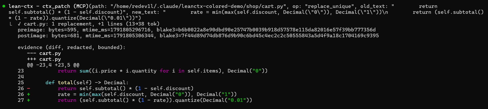
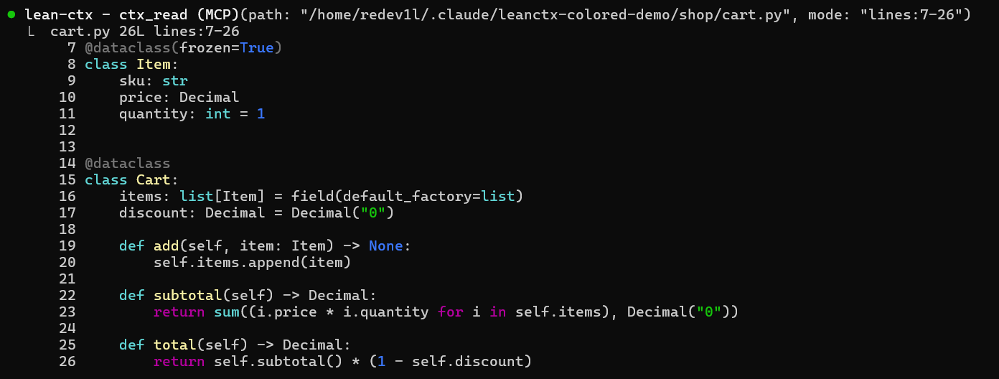
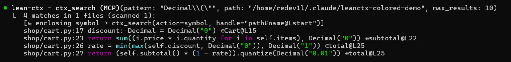

# LeanCTX Colored

A Claude Code mod that draws the output of the lean-ctx MCP server in color.

- **ctx_patch**: the unified diff becomes rows with line numbers (the old file's for removed lines,
  the new file's for added and context lines), colored `+`/`-` markers and every line
  syntax-highlighted in the file's language. The rest of the response (preimage, brace-balance)
  stays as dim text.
- **ctx_read**: `lines`, `anchored`, `full`/`raw` and multi-file reads are drawn as highlighted
  code with a line-number gutter. Anchor hashes are hidden on screen; the model still gets them.
- **ctx_search**: each hit shows a dim `path:line`, the highlighted line, and the `∈symbol@L…`
  enclosing-symbol note right after the code.

Only the drawing changes: the model receives the tool output untouched. Whatever the mod does not
recognise (signatures and map modes, errors, calls still running) Claude Code draws as usual.

## Screenshots

**ctx_patch**



**ctx_read**



**ctx_search**



## Install

In a Claude Code terminal session:

```
/plugin install leanctx-colored --marketplace ReDev1L/leanctx-colored
```

Answer `y` to add the marketplace, then pick a scope: the user scope loads the mod in every
session, including local sessions of the desktop app.

## Requirements

- Claude Code with mods (function hooks); built and tested against 2.1.296.
- lean-ctx registered as an MCP server named `lean-ctx`, so its tools are
  `mcp__lean-ctx__ctx_patch`, `mcp__lean-ctx__ctx_read` and `mcp__lean-ctx__ctx_search`.

## Development

```bash
git clone https://github.com/ReDev1L/leanctx-colored
cd leanctx-colored
claude plugin validate .
claude plugin test .
claude --plugin-dir .   # a session with the mod loaded from this folder, reloaded on save
```

`tsc -p .` type-checks the mod once Claude Code has loaded it and written the API types to
`.claude-plugin/types/` (git-ignored).

## License

[MIT](LICENSE)
